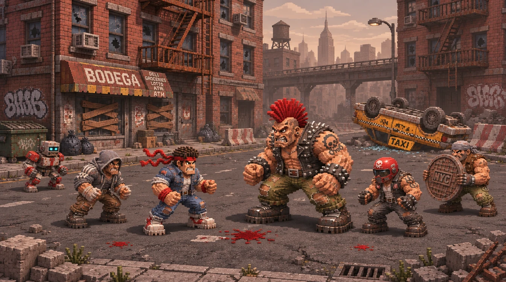

# 아트 디렉션 — 메탈펀치 뱀돌이

> 2026-11-27 · Higgsfield(GPT Image 2.6)로 만든 콘셉트 이미지를 기준으로 정리.
> **2026-11-27 확정: 목표 화면 = `docs/art/target_ingame.webp`** (배경 뉴욕, 아래 '0. 확정 기준' 참고)
> 이 문서는 **목표 화면의 기준서**다. 게임 그래픽을 바꿀 때와 콘셉트 이미지를 새로 만들 때 이 문서를 따른다.

---

## 0. 확정 기준 (2026-11-27)


| 파일 | 내용 |
|---|---|
| `art/target_ingame.webp` | **최종 목표 화면.** 사용자가 "제일 알맞다"고 고른 이미지 (Higgsfield 작업 `7d46adae-bf8b-43b5-929e-5c035111c230`) |
| `art/lineup_ref.webp` | 캐릭터 디자인 라인업 (위 목표 화면의 디자인 출처, 작업 `01918146-35a1-437f-b302-e881d45fcc6f`) |
| `art/keyart_ny.webp` | 처음 뉴욕 키아트. 모히칸 덩치의 생김새·비율이 마음에 든다는 평 (작업 `f4d166c0…` 또는 `fae86aba…`) |

- **배경: 폐허가 된 뉴욕으로 확정** (한국 뒷골목 안 기각).
- **복셀 느낌을 분명하게**: 매끈한 조각 대신 각진 정육면체 블록이 보이게. 둥근 것(주먹·머리·헬멧·맨홀)도 계단처럼 각지게.
- **두 체형 클래스**
  - **큰 체형** (모히칸 덩치 등): 보통 체형보다 **머리 하나 반가량 큼**(키 약 1.4배). 거대한 어깨·팔, 굵고 짧은 다리, 육중한 부츠.
  - **보통 체형** (뱀돌이, 후드 깡패, 폭주족, 맨홀 방패병): **짜리몽땅**. 약 2.5~3등신, 큰 머리, 넓고 짧은 몸통, 굵은 팔에 **큼직한 주먹**, 짧고 굵은 다리를 넓게 벌린 자세, 두툼한 신발.
  - **볼트**: 보통 체형보다 작은 네모난 로봇.
- 캐릭터 디자인은 라인업 기준: 뱀돌이(빨간 머리띠 꼬리, 곱슬 갈색 머리, 청재킷 소매 걷음, 흰 티, 찢어진 청바지, 빨강·흰 운동화, 빨간 손목 붕대) / 볼트(회색·빨강, 청록 눈) / 후드 깡패 / 모히칸 덩치(징 박힌 조끼) / 빨간 풀헬멧 폭주족 / 두건 맨홀 방패병.
- 이 이미지를 Higgsfield에서 참고 이미지로 다시 쓰려면 위 작업 ID를 `medias`에 `image_references`로 넣는다 (업로드 불필요).

## 1. 한 줄 방향
**"버려진 도시의 바랜 흙빛 위에, 오직 피만 선명하다."**

복셀(블록) 세계가 된 황폐한 도시. 배경은 1987년 아케이드 『더블드래곤』처럼 차분하고 바랜 색, 그 위에서 튀는 **진홍색 피**가 화면에서 유일하게 강렬한 색이다. 픽셀 아트라는 핑계로 잔인함을 실컷 보여 주되, 화면은 지저분하지 않고 읽기 쉬워야 한다.

## 2. 핵심 원칙
1. **채도는 배경 < 캐릭터 < 피.** 배경은 가장 차분하게, 캐릭터는 약간 바랜 원색, 피는 최대 채도.
2. **네온·알록달록 금지.** 간판은 꺼져 있고, 빛은 흐린 낮의 평평한 빛이 기본.
3. **폐허의 디테일로 분위기를 낸다.** 색이 아니라 녹, 금, 잔해, 먼지, 낙서로.
4. **선명한 색은 의미가 있을 때만**: 피(진홍), 동전(노랑), 공격 예고(청록). 그 외에는 선명한 색을 쓰지 않는다.
5. **고급스러움은 빛과 그림자로.** 부드러운 전역 조명, 복셀 틈새 그늘(앰비언트 오클루전), 옅은 먼지 안개. 효과는 과하지 않게.

## 3. 팔레트
### 배경 (낮은 채도, 흙빛)
| 용도 | 색 | 메모 |
|---|---|---|
| 바랜 벽돌 | `#8A5A48` | 주 건물 벽 |
| 바랜 연분홍(살구) | `#B88A78` | 더블드래곤풍 벽면·회벽 |
| 흙갈색 | `#6B5444` | 나무, 문, 녹 |
| 카키 | `#9A8F6E` | 천막, 페인트 벗겨진 면 |
| 잿빛 | `#7D7A74` | 콘크리트, 돌길 |
| 먼지 베이지 | `#B8AB94` | 보도, 먼지 낀 바닥 |
| 아스팔트 | `#4A4846` | 도로 |
| 녹 | `#8C5A3A` | 철제 비상계단, 셔터, 차 |
| 흐린 하늘·안개 | `#9A9690` | 회갈색, 해는 보이지 않음 |

### 강조 (의미 있는 색만)
| 용도 | 색 | 규칙 |
|---|---|---|
| 피 (밝은) | `#E0182C` | 막 튄 피, 절단면 |
| 피 (기본) | `#C8102E` | 핏자국 |
| 피 (마른·짙은) | `#7A0A14` | 많이 묻은 곳, 오래된 자국 |
| 동전 | `#FFD400` | 반짝임 포함 (현재 게임과 같음) |
| 공격 예고 | `#7FF6FF` | 청록 깜빡임과 '!' (피와 겹치지 않게) |

### 캐릭터
- 원래 색(뱀돌이: 빨간 머리띠·파란 재킷 / 볼트: 회색·빨강)은 유지하되 **채도를 15~25% 낮춘다.**
- 피가 묻으면 그 부분만 선명한 진홍으로 드러난다.

## 4. 빛·대기
- **기본: 흐린 낮.** 먼지 낀 확산광, 그림자는 부드럽고 짧다.
- **안개**: 옅은 회갈색 먼지 안개. 멀수록 배경이 하늘색으로 녹아든다.
- **광원은 불만**: 불타는 차, 폭발, 드럼통. 이때만 주황빛이 주변을 물들인다.
- 블룸(빛 번짐)은 **피·불·동전에만 약하게.**

## 5. 배경 (환경)
### 공통 폐허 요소
- 꺼지고 금 가고 녹슨 간판, 깨지거나 판자로 막은 창문
- 녹슨 셔터와 낙서, 무너진 벽과 잔해 더미
- 갈라진 아스팔트와 바랜 차선, 돌길 틈의 잡초
- 녹슬고 불탄 차, 뒤집힌 차
- 흩어진 쓰레기와 신문지, 기울어진 가로등, 끊어져 늘어진 전선

### 도시 배경 — 두 안 (**B안 뉴욕으로 확정**, 2026-11-27)
| | A. 한국 뒷골목 (현재 게임) | B. 폐허가 된 뉴욕 (새 콘셉트) |
|---|---|---|
| 건물 | 2~3층 상가, 셔터, 벽돌 골목 | 적갈색 브라운스톤·공동주택, 지그재그 비상계단, 옥상 물탱크 |
| 간판 | 꺼진 한글 간판 (치킨·노래방·PC방·포차) | 바랜 영어 간판 (DELI, PAWN SHOP, LIQUOR, HOTEL) |
| 거리 소품 | 전봇대·늘어진 전선, 쓰레기통 | 녹슨 지하철 입구, 고가 선로, 소화전, 맨홀 증기 |
| 차량 | 녹슨 승용차 | 녹슬고 뒤집힌 노란 택시, 불탄 차 |
| 원경 | 낮은 상가 지붕들 | 안개 속 부서진 맨해튼 마천루 |

> 세계관(블록 쇼크, 언더커버 캅스풍)과 연결해 어느 쪽으로 갈지 정한 뒤, 기획서 세계관과 게임 도심 바이옴을 함께 바꾼다.

### 다른 바이옴도 같은 톤으로
- **폐허 초원**: 바랜 풀, 회색 콘크리트 잔해, 마른 흙
- **모래 공업지대**: 먼지 낀 황토, 녹슨 공장 설비
- **얼어붙은 항구**: 잿빛 눈, 녹슨 컨테이너, 탁한 바다
- 모두 **피가 가장 선명한 색**이라는 원칙을 지킨다.

## 6. 캐릭터
- 큼직하고 단순한 블록 실루엣. 멀리서도 누가 누군지 알아볼 수 있게 **머리 모양과 실루엣**으로 구분한다(모히칸 덩치, 맨홀 방패병, 빨간 풀헬멧 폭주족 등).
- 살아 있는 적에게는 피가 덜 묻는다 (게임 규칙과 같음).
- 미세 복셀 디테일(주름, 벨트, 바느질) 정도는 넣되, 색 수는 적게.

## 7. 고어·이펙트
- 피는 **진홍색 복셀 큐브**로 튄다. 실사 피가 아니라 만화적인 블록 덩어리.
- 핏자국은 바닥과 벽 표면에 직접 칠해진다. 배경이 차분해서 멀리서도 잘 보인다.
- 잘린 머리·팔·다리는 통통 튀다 멈추고, 튈 때마다 핏방울이 남는다.
- **큰 글씨 효과는 쓰지 않는다.** 타격감은 빛, 흔들림, 파편, 잔상으로 낸다.
- 숄더 태클의 청백색 잔상, 주먹 타격선 같은 연출은 **흰색·청록 계열**로 피와 섞이지 않게 한다.

## 8. UI
- 최소한의 HUD: 왼쪽 위에 초상화와 체력바, 오른쪽 위에 동전 수.
- UI 색도 차분하게. 체력바만 선명하게.

## 9. 기각한 방향
- **네온 야경 + 젖은 바닥 반사 + 알록달록한 간판** (첫 콘셉트): 고급스럽지만 **너무 화려해서 피가 묻히고, 황폐한 느낌이 없어** 기각.

## 10. 실제 게임에 적용하는 순서 (제안)
1. **팔레트**: 바이옴 색, 하늘·안개 색을 이 문서의 표로 교체. 마지막에 화면 전체 채도 보정을 넣되 **피·동전·예고 색은 제외.**
2. **폐허 소품**: 잔해, 판자 창문, 녹슨 셔터, 불탄 차, 끊어진 전선, 바닥 균열과 잡초.
3. **렌더링 품질**: 앰비언트 오클루전, 부드러운 그림자, 먼지 안개, 피·불에만 약한 블룸.

## 11. 콘셉트 이미지 생성 기록 (Higgsfield, GPT Image 2.6, 16:9, 품질 medium)
아래 프롬프트를 바탕으로 장면만 바꿔 쓰면 톤이 유지된다.

### 공통 톤 문장 (모든 프롬프트 끝에 붙이기)
```
Overcast dusty daylight, very low saturation, muted earthy palette like a late-80s arcade brawler (Double Dragon):
faded brick red-brown, dull brown, khaki, ash gray, dusty beige.
Comic-style crimson red voxel splash bursts from the impact and red voxel splats on the ground:
the red is the only vivid color and stands out sharply against the drab city. A few muted gold coins.
Rendering: soft global illumination, ambient occlusion, gentle haze, crisp micro voxel detail, gritty AAA indie quality.
Minimal HUD: portrait and health bar top-left, coin counter top-right.
```

### B안 — 폐허가 된 뉴욕 대로
```
High-end modern voxel art screenshot of a side-scrolling arcade beat 'em up, elevated 3/4 front camera.
A ruined, abandoned New York City street: crumbling red-brown brick brownstones and tenement buildings with rusty
zigzag fire escapes, wooden rooftop water towers, boarded-up storefronts with dead faded English signs (DELI, PAWN SHOP,
LIQUOR, HOTEL), a collapsed subway entrance with rusted green railings, a rusted abandoned yellow taxi cab and burnt-out
cars, a dented dumpster against a graffiti wall, leaning street lamps, a broken fire hydrant, rubble, cracked asphalt
with a faded double yellow line, a hazy ruined Manhattan skyline with broken skyscrapers far behind.
Center: a chunky voxel hero with a red headband and blue jacket swinging a nail-studded bat into a huge shirtless mohawk
thug; a gray-and-red boxy robot companion on the left; a trooper holding a manhole cover as a shield on the right;
a biker in a red helmet on a motorcycle in the background.  + 공통 톤 문장
```

### A안 — 황폐한 한국 뒷골목
```
... Desolate abandoned Korean downtown street: dead unlit shop signs (치킨, 노래방, PC방, 포차) faded, cracked and rusted,
broken and boarded-up shop windows, crumbling concrete and brick, an abandoned rusty car, a dented green dumpster with
trash bags against a graffiti brick wall, leaning power poles with tangled dead wires, rubble and dust on a dry cracked
asphalt road with a faded yellow line and worn crosswalk. ...  + 공통 톤 문장
```

### 주의
- **피(blood)·고어가 들어간 이미지를 참고 이미지로 넣고 편집하면 안전 필터에 걸린다.** 새로 만들 때는 참고 이미지 없이 글로 구도를 묘사하고, 피는 "comic-style crimson red voxel splash" 같은 만화적 표현으로 쓴다.
- 이 클라우드 작업 환경에서는 `upload.higgsfield.ai`와 결과 이미지 주소(cloudfront)가 네트워크 정책에 막혀 있다. 게임 스크린샷을 참고로 쓰려면 환경 설정에서 허용하거나 내 PC에서 작업한다.
